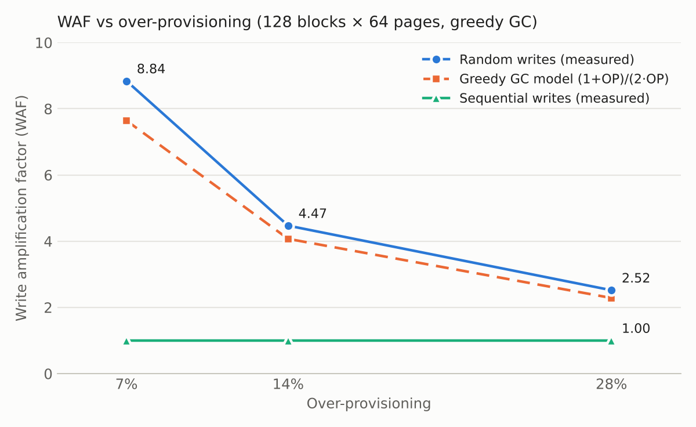

# mini-ftl

A page-level **Flash Translation Layer (FTL) simulator** written in plain C. It models the core firmware logic of an SSD controller: out-of-place writes, logical-to-physical mapping, greedy garbage collection and dynamic wear leveling, and measures the resulting **write amplification (WAF)**.

The code is written in an embedded style: fixed-size static arrays, no dynamic allocation, and page state tracked with 64-bit bitmaps.



## Why an FTL is needed

NAND flash has three constraints that a host does not expect from a block device:

| NAND constraint | What the FTL does |
|---|---|
| A page cannot be overwritten in place | Writes every update to a fresh page and remaps the LPN (out-of-place write) |
| Erase works only on a whole block | Garbage collection relocates still-valid pages, then erases the block |
| Each block survives a limited number of erases | Wear leveling spreads erases evenly across blocks |

## Design

**Geometry.** 128 blocks × 64 pages (8192 physical pages). The number of logical pages exposed to the host is `physical / (1 + OP)`, where OP is set at compile time.

**Page state: bitmap + write pointer.** Each block keeps one `uint64_t` valid bitmap and a write pointer. Because NAND pages must be programmed in order, these two fields fully describe every page:

```
index >= write_ptr               -> FREE
index <  write_ptr, bit == 1     -> VALID
index <  write_ptr, bit == 0     -> INVALID
```

**Mapping.** `l2p[]` maps logical pages to physical pages. `p2l[]` is the reverse map; it models the LPN that real firmware stores in each page's out-of-band (OOB) area, which GC needs to find the owner of a page it relocates.

**Block lifecycle.** `FREE -> ACTIVE -> FULL -> (GC erase) -> FREE`

**Write path (`ftl_write`).**
1. If free blocks fall below `GC_THRESHOLD` (2), run GC. One free block is always kept in reserve so GC has somewhere to relocate data.
2. Read the current mapping. This must happen *after* GC, because GC may have moved this LPN.
3. Program the next free page of the active block.
4. Invalidate the old page and update `l2p` / `p2l`.

**Garbage collection (greedy).** Pick the `FULL` block with the fewest valid pages, relocate its valid pages to the active block, then erase it.

**Wear leveling (dynamic).** When a new block is needed, allocate the `FREE` block with the lowest erase count.

**Consistency checker.** `ftl_check_consistency()` verifies:
- each block's `valid_count` equals the popcount of its bitmap
- `free_block_count` matches the number of `FREE` blocks
- `erase_total` equals the sum of per-block erase counts
- `l2p` and `p2l` agree, and every mapped page is valid
- no leaked valid pages (total valid pages equals the number of mapped LPNs)

## Results

Each run fills the drive once, then issues 20× the logical capacity in host writes. WAF is measured in steady state (the initial fill is excluded).

| OP | Sequential WAF | Random WAF | Greedy model (1+OP)/(2·OP) | Avg erase count | Erase count range |
|---|---|---|---|---|---|
| 7% | 1.00 | **8.84** | 7.64 | 165 | 151 – 173 |
| 14% | 1.00 | **4.47** | 4.07 | 78 | 71 – 82 |
| 28% | 1.00 | **2.52** | 2.29 | 39 | 36 – 41 |

**Observations**
- **Sequential writes need no relocation.** A whole block becomes invalid before it is reused, so GC victims contain no valid pages and WAF stays at 1.0.
- **Doubling OP roughly halves random-write WAF.** More spare space lets GC wait until victims hold fewer valid pages.
- **Measured WAF tracks the analytical model** at about 1.1× across all three settings. The gap comes from the small drive: the reserved GC block and the active block take a noticeable share of the spare space, so the effective OP is lower than the nominal value.
- **Wear stays even.** The spread between the most and least erased block is about 13% of the average in every run. Dynamic wear leveling only balances blocks that are being rewritten; cold data would require static wear leveling.

## Build and run

**GCC / Clang**
```bash
gcc -std=c11 -Wall -Wextra -O2 ftl.c test_ftl.c -o test_ftl
./test_ftl

# Different over-provisioning
gcc -std=c11 -O2 -DOP_PERCENT=28 ftl.c test_ftl.c -o test_ftl
```

**Visual Studio 2022**
Open `mini-ftl.sln`. The project is compiled as C11 (`/std:c11`). To change OP, add `OP_PERCENT=28` under *C/C++ → Preprocessor → Preprocessor Definitions*. Use the Debug configuration to keep the `assert` checks inside the FTL enabled.

**Sample output (OP 7%)**
```
[PASS] basic read/write
[PASS] out-of-place update
[PASS] GC keeps mapping correct (gc_count=10510)

workload,op_percent,waf
sequential,7,1.000
random,7,8.839
```

## Files

| File | Contents |
|---|---|
| `ftl.h` | Geometry, data structures, public interface |
| `ftl.c` | NAND model, mapping, GC, wear leveling, stats, consistency checker |
| `test_ftl.c` | Unit tests and the WAF experiment |
| `docs/waf_vs_op.png` | Results chart |

## Possible extensions

- TRIM support (`ftl_trim` is declared but not implemented)
- Static wear leveling for cold data
- Hot/cold data separation into different active blocks
- Cost-benefit GC victim selection, compared against greedy
- Bad block management
- Skewed workloads (e.g. 80/20 hot/cold access) instead of uniform random
